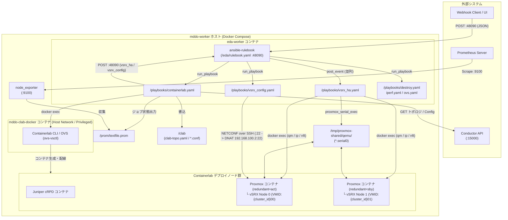
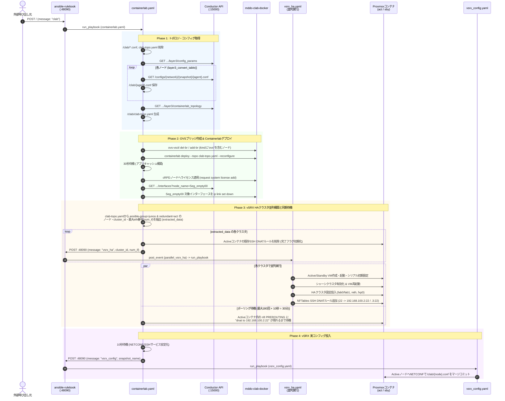
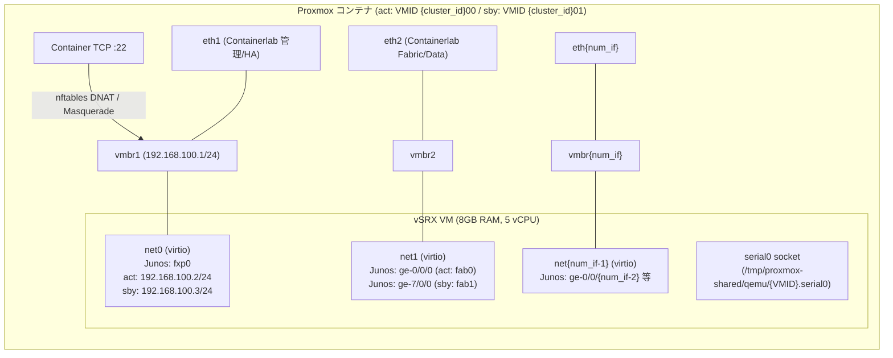

# mddo-worker 設計書

本リポジトリ（`mddo-worker`）は、Event-Driven Ansible (`ansible-rulebook`) を用いて外部（Conductor等）からのWebhookイベントを受信し、ContainerlabによるネットワークトポロジのデプロイおよびProxmoxコンテナ上のJuniper vSRX（Active/Standby HAクラスタ構成）の自動プロビジョニングを実行するワーカーシステムです。

---

## 1. システム全体アーキテクチャ

### 1.1 コンポーネント構成



### 1.2 主要ディレクトリ・ファイル構成

| パス | 役割 |
| :--- | :--- |
| `docker-compose.yaml` | `mddo-clab-docker`, `eda-worker`, `node_exporter`, `cadvisor` の4コンテナおよび共有ボリューム・ネットワーク定義 |
| `.env` | コンテナイメージ・タグおよびホスト側作業ディレクトリ (`WORKERDIR`) の環境変数定義 |
| `ansible-eda/rulebook.yaml` | Webhook (`0.0.0.0:48090`) を待ち受け、メッセージ種別に応じてPlaybookを実行・並列ディスパッチするEDAルールブック |
| `playbooks/containerlab.yaml` | トポロジ・初期コンフィグの取得、Containerlab環境のデプロイ、vSRX HA構築ジョブの並列トリガーと完了待機、最終コンフィグ投入までを統括するメインPlaybook |
| `playbooks/vsrx_ha.yaml` | 指定された `cluster_id` のActive/Standby Proxmoxコンテナ内にvSRX VMを構築し、シリアル経由でHA（シャーシクラスタ）設定およびSSHポートフォワーディングを構成するPlaybook |
| `playbooks/vsrx_config.yaml` | HA構成完了後のvSRX（Activeノード）に対し、NETCONF経由でコンフィグファイル（`/clab/*.conf`）をマージ投入するPlaybook |
| `playbooks/destroy.yaml` | Containerlab環境の破棄用Playbook |
| `playbooks/iperf.yaml` | iperfトラフィック試験ノード設定用Playbook |
| `playbooks/ovs.yaml` | Open vSwitchブリッジのポート操作（`add-port` / `del-port`）用Playbook |

### 1.3 Docker Compose サービス・ネットワーク・ボリューム設計 (`docker-compose.yaml`)

#### コンテナサービス一覧
| サービス名 | イメージ (`変数名`) | ネットワーク / 公開ポート | 特権 / PID | 役割・起動コマンド |
| :--- | :--- | :--- | :--- | :--- |
| `mddo-clab-docker` | `${MDDO_CLAB_DOCKER_IMAGE}:${MDDO_CLAB_DOCKER_IMAGE_TAG}` | `network_mode: "host"` | `privileged: true`<br/>`pid: "host"` | ContainerlabおよびOpen vSwitch (`ovs-vsctl`) 実行環境。作業ディレクトリは `${WORKERDIR}/clab` |
| `eda-worker` | `${ANSIBLE_EDA_IMAGE}:${ANSIBLE_EDA_IMAGE_TAG}` | `default` (`172.32.0.0/24`)<br/>`48090:48090` | `privileged: true` | `ansible-rulebook -r /eda/rulebook.yaml -i /eda/hosts -vvvv` を常駐実行し、Webhook受信とPlaybook実行を担当 |
| `node_exporter` | `quay.io/prometheus/node-exporter:v1.8.2` | `default` (`172.32.0.0/24`)<br/>`9100:9100` | `pid: "host"` | ホストメトリクスおよび `/prom/textfile.prom`（コンテナ内 `/data`）のジョブステータスをPrometheusへ公開 |
| `cadvisor` | `gcr.io/cadvisor/cadvisor:v0.38.6` | `default` (`172.32.0.0/24`)<br/>`30080:8080` | - | コンテナごとのリソース使用状況メトリクスを収集・公開 |

> [!NOTE]
> `docker-compose.yaml` の `default` ブリッジネットワークにはサブネット `172.32.0.0/24` が割り当てられています。`containerlab.yaml` から `vsrx_ha` イベントをトリガーする際に `remote_address: "172.32.0.1"` を指定しているのは、コンテナ側からこのDockerブリッジのゲートウェイ（ホスト側IP）を経由してアクセスするためです。

#### バインドマウント（共有ボリューム）設計
`mddo-clab-docker` と `eda-worker` では、Dockerソケットやネットワーク名前空間、シリアルソケット等をホストOSと共有するため **`type: bind`** でマウントしています。

| ホスト側パス (`source`) | `mddo-clab-docker` 内 (`target`) | `eda-worker` 内 (`target`) | `node_exporter` 内 | 用途・設計上の注意点 |
| :--- | :--- | :--- | :--- | :--- |
| `/var/run/docker.sock` | `/var/run/docker.sock` | `/var/run/docker.sock` | - | コンテナ内からホストのDockerデーモンを操作（DooD: Docker outside of Docker） |
| `/var/run/netns` | `/var/run/netns` | `/var/run/netns` | - | Containerlabが作成するコンテナ間リンクのNetwork Namespace共有（※ホスト側に事前作成が必要） |
| `/etc/hosts` | `/etc/hosts` | `/etc/hosts` | - | Containerlabが自動追記するノード名名前解決エントリの共有 |
| `/var/lib/docker/containers` | `/var/lib/docker/containers` | `/var/lib/docker/containers` | - | Dockerコンテナ領域への直接アクセス |
| `${WORKERDIR}/clab` | `${WORKERDIR}/clab` | `/clab` | - | トポロジ定義 (`clab-topo.yaml`)、機器コンフィグ (`*.conf`)、cRPDライセンス (`license.key`) の共有領域（※`mddo-clab-docker` はホストと同パスでマウント） |
| `/tmp/proxmox-shared/` | `/tmp/proxmox-shared/` | `/tmp/proxmox-shared/` | - | Proxmoxコンテナ内のQEMU/KVMが出力するvSRXシリアルコンソールソケット (`/tmp/proxmox-shared/qemu/{VMID}.serial0`) を `eda-worker` の `proxmox_serial_exec` モジュールから操作するための共有領域（※ホスト側に事前作成が必要） |
| `./ansible-eda` | `/eda` | `/eda` | - | `rulebook.yaml` およびインベントリ (`hosts`) の格納領域 |
| `./playbooks/` | - | `/playbooks` | - | 各種Ansible Playbookおよびカスタムモジュール (`library/proxmox_serial_exec.py`) の格納領域 |
| `./prom` | - | `/prom` | `/data` | Playbookが書き込む `textfile.prom` を `node_exporter` の `--collector.textfile.directory=/data` で収集 |

---

## 2. Event-Driven Ansible (Rulebook) 設計

`ansible-eda/rulebook.yaml` は2つのルールセットで構成され、`execution_strategy: parallel` により複数イベントの並列実行をサポートします。

### 2.1 ルールセット一覧

1. **`deploycontainerlab`** (`hosts: all`, `execution_strategy: parallel`)
   - **イベントソース**: `ansible.eda.webhook` (`host: 0.0.0.0`, `port: 48090`)
   - 外部および内部PlaybookからのHTTP POSTリクエストを受信し、`event.payload.message` の値によって処理を分岐します。
2. **`parallel_vsrx_ha`** (`hosts: localhost`, `execution_strategy: parallel`)
   - **イベントソース**: なし（内部 `post_event` 専用）
   - `deploycontainerlab` ルールセットから `post_event` アクションで転送された `vsrx_ha` イベントを受け取り、クラスタ単位で `/playbooks/vsrx_ha.yaml` を非同期・並列実行します。

### 2.2 Webhook イベント仕様 (`event.payload.message`)

| `message` 値 | ルール名 | 実行アクション / Playbook | 主な `extra_vars` / パラメータ |
| :--- | :--- | :--- | :--- |
| `"clab"` | `clab deploy` | `run_playbook`: `/playbooks/containerlab.yaml` | `network_name`, `crpd_image`, `endpoint_image`, `snapshot_name`, `usecase_name`, `with_clab: "true"`, `remote_address` |
| `"iperf"` | `setup iperf node` | `run_playbook`: `/playbooks/iperf.yaml` | `network_name`, `crpd_image`, `snapshot_name`, `usecase_name`, `with_clab: "true"`, `iperf_commands`, `remote_address` |
| `"destroy"` | `clab destroy` | `run_playbook`: `/playbooks/destroy.yaml` | `network_name`, `crpd_image`, `endpoint_image`, `snapshot_name`, `usecase_name`, `with_clab: "true"`, `remote_address` |
| `"shutdown"` | `shutdown webhook` | `shutdown` (15秒ディレイ) | - |
| `"ovs"` | `operate ovs bridge operation` | `run_playbook`: `/playbooks/ovs.yaml` | `network_name`, `snapshot_name`, `usecase_name`, `operation`, `bridge_name`, `port_name` |
| `"vsrx_ha"` | `route vsrx ha deployment` | `post_event` → `parallel_vsrx_ha` ルールセットへ転送し `/playbooks/vsrx_ha.yaml` を実行 | `snapshot_name` (既定: `'emulated_asis'`), `cluster_id` (既定: `1`), `password` (既定: `'password123'`), `remote_address`, `num_if` (既定: `5`), `node_0_id` (`0`), `node_1_id` (`1`), `node_0_ip` (`'192.168.100.2/24'`), `node_1_ip` (`'192.168.100.3/24'`), `node_0_if` (`'ge-0/0/0'`), `node_1_if` (`'ge-7/0/0'`) |
| `"vsrx_config"` | `vsrx config` | `run_playbook`: `/playbooks/vsrx_config.yaml` | `snapshot_name` (既定: `'emulated_asis'`) |

---

## 3. デプロイ・プロビジョニング処理フロー

`message: "clab"` を受信した際の全体シーケンスは以下の通りです。`containerlab.yaml` がオーケストレーターとして機能し、複数のvSRX HAクラスタが存在する場合でもEDAのローカルWebhookへ `vsrx_ha` イベントをループ送信することでクラスタ構築を並列化し、NFTablesのDNATルール設定完了を完了シグナルとして待ち合わせます。



---

## 4. Playbook 詳細設計

### 4.1 `playbooks/containerlab.yaml`（全体オーケストレーション）

Containerlab環境の初期構築からvSRX HAプロビジョニングの呼び出しまでを一貫して制御します。

#### 入力変数 (`vars` / `extra_vars`)
| 変数名 | 既定値 | 説明 |
| :--- | :--- | :--- |
| `network_name` | (Webhookから渡される) | 対象ネットワーク名 |
| `snapshot_name` | (Webhookから渡される) | 対象スナップショット名 |
| `usecase_name` | (Webhookから渡される) | ユースケース名 |
| `crpd_image` | (Webhookから渡される) | Juniper cRPD コンテナイメージ名 |
| `endpoint_image` | (Webhookから渡される) | エンドポイント用コンテナイメージ名 |
| `with_clab` | `"true"` | Containerlab操作を実行するかどうかのフラグ |
| `remote_address` | `localhost` | Conductorが稼働するホストのアドレス |
| `conductor_address` | `{{ remote_address }}:15000` | Conductor APIの接続先エンドポイント |
| `topology_file` | `"/clab/clab-topo.yaml"` | 生成するContainerlabトポロジ定義ファイルのパス |

#### 処理ステップ詳細
1. **クリーンアップ**:
   - `/clab/*.conf`、`/clab/clab-topo.yaml`、`/clab/iperf_params.json` を削除。
2. **コンフィグ・トポロジの取得 (`Preparing_Deploy_Clab`)**:
   - Conductor API (`/topologies/{network_name}/{snapshot_name}/topology/layer3/config_params`) から変換テーブルを取得。
   - 各エージェントのコンフィグ (`/configs/{network_name}/{snapshot_name}/{agent_name}.conf`) を取得し、`jq -r .text` で `/clab/{agent_name}.conf` に保存。
   - Conductor API (`/topologies/{network_name}/{snapshot_name}/topology/layer3/containerlab_topology?...`) からContainerlabトポロジJSONを取得し、YAML形式で `/clab/clab-topo.yaml` に出力。
3. **OVSブリッジの初期化 (`Setting_ovs-br`)**:
   - トポロジ内のノードで `kind` に `"ovs"` を含むものについて、`mddo-clab-docker` コンテナ内で `ovs-vsctl del-br` および `ovs-vsctl add-br` を実行。
4. **Containerlabのデプロイ (`Deploying_Containerlab`)**:
   - `docker exec mddo-clab-docker containerlab deploy --topo clab-topo.yaml --reconfigure` を実行。
   - 30秒のPause後、`clab-node-kind=juniper_crpd` ラベルを持つ全ノードに対して `cli request system license add /tmp/license.key` を実行しBGP等のライセンスを有効化。
5. **未接続（空）ノードのインターフェースシャットダウン**:
   - Conductor APIから `node_name=Seg_empty00` のインターフェース一覧を取得し、`alias.l1_principal` に記載されたインターフェースを `mddo-clab-docker` 内で `ip link set <if> down` に設定。
6. **vSRXクラスタ情報の抽出 (`extracted_data`)**:
   - `/clab/clab-topo.yaml` を読み込み、以下の条件を満たすノードを抽出：
     - `labels['ansible-group'] == 'junos'`
     - `labels['redundant'] == 'act'`
   - 該当ノードの `labels['clusterid']` を取得し、さらに `topology.links` の `endpoints` から `<node_name>:ethX` の最大インターフェース番号 `X` を計算して `num_if` として保持。
7. **vSRX HAデプロイの並列トリガーと完了待機 (`Deploying_vSRX_HA`)**:
   - `extracted_data` が1件以上存在する場合に実行。
   - **完了判定フラグのリセット**: Activeコンテナ（`clab-{{ snapshot_name }}-{{ item.node }}`）内の `nft delete rule ip nat PREROUTING tcp dport 22 dnat to 192.168.100.2:22` を事前削除。
   - **並列ジョブ起動**: `http://127.0.0.1:48090/` へ `message: "vsrx_ha"` をクラスタごとにPOST。
   - **完了ポーリング**: 各Activeコンテナの `nft list chain ip nat PREROUTING` に `dnat to 192.168.100.2:22` が登録されるまで待機（10秒間隔 × 最大180回 = 最大30分）。
8. **vSRXコンフィグ投入のトリガー (`Configuring_vSRX`)**:
   - 全クラスタのHA構築完了後、10秒待機してから `http://127.0.0.1:48090/` へ `message: "vsrx_config"` をPOST。

#### Prometheus メトリクス出力 (`/prom/textfile.prom`)
処理の進行状況は `node_exporter` の Textfile Collector 経由でPrometheusから監視できるよう、各フェーズの開始時に `1`、完了時に `0` が書き込まれます。
- `job_status{jobname="Preparing_Deploy_Clab",network_name="...",snapshot_name="..."}`
- `job_status{jobname="Setting_ovs-br",network_name="...",snapshot_name="..."}`
- `job_status{jobname="Deploying_Containerlab",network_name="...",snapshot_name="..."}`
- `job_status{jobname="Deploying_vSRX_HA",network_name="...",snapshot_name="..."}`
- `job_status{jobname="Configuring_vSRX",network_name="...",snapshot_name="..."}`

---

### 4.2 `playbooks/vsrx_ha.yaml`（Proxmox上でのvSRX HAクラスタ構築）

Containerlabによって起動されたProxmox VEコンテナ（Active用・Standby用の2台1組）の内部で、QEMU/KVMを用いてvSRX VMをデプロイし、Junosシャーシクラスタ（HA）を構成します。

#### 入力変数 (`vars` / `extra_vars`)
| 変数名 | 既定値 (rulebook定義) | 説明 |
| :--- | :--- | :--- |
| `snapshot_name` | `'emulated_asis'` | トポロジデータ検索用スナップショット名 |
| `cluster_id` | `1` | 対象クラスタID（VMIDおよびJunos cluster-idに使用） |
| `num_if` | `5` | ブリッジ接続するインターフェース数（`eth1`〜`eth{num_if}`） |
| `password` | `'password123'` | vSRXの `root` パスワード |
| `node_0_id` / `node_1_id` | `0` / `1` | Active / Standby それぞれのJunosクラスタノードID |
| `node_0_ip` / `node_1_ip` | `'192.168.100.2/24'` / `'192.168.100.3/24'` | Node 0 / Node 1 の管理インターフェース (`fxp0.0`) IPアドレス |
| `node_0_if` / `node_1_if` | `'ge-0/0/0'` / `'ge-7/0/0'` | ファブリックリンク (`fab0` / `fab1`) に割り当てるメンバーIF |

#### コンテナ・VM・ネットワーク設計



#### VMスペックとID体系
- **対象コンテナの特定**: `/clab/clab-{{ snapshot_name }}/topology-data.json` から、`labels.clusterid == cluster_id` かつ `labels.redundant == 'act'`（または `'sby'`）のコンテナ名（`clab-node-longname`）を動的に取得します。
- **VMID規則**:
  - Activeノード (`redundant: act`): **`{{ cluster_id }}00`**（例: `cluster_id=1` の場合は `100`）
  - Standbyノード (`redundant: sby`): **`{{ cluster_id }}01`**（例: `cluster_id=1` の場合は `101`）
- **ハードウェア構成**:
  - OVFテンプレート: `/var/tmp/junos-vsrx3-x86-64.ide.ovf`（`qcow2` 形式でインポート）
  - リソース: メモリ `8192 MB`、CPU `5 cores` (`cputype=host`)、SCSIコントローラ `virtio-scsi-pci`、ブート順序 `order=scsi0`
  - シリアルコンソール: `--serial0 socket --vga serial0`（ホスト・コンテナ間共有ディレクトリ `/tmp/proxmox-shared/qemu/{VMID}.serial0` 経由でカスタムモジュール `proxmox_serial_exec` が操作）

#### 処理ステップ詳細
1. **Activeノード (`act_target`) のVM構築・起動・初期設定**:
   - `/opt/qemu-shared` を `/var/run/qemu-server` に内部バインドマウント。
   - 既存VM (`{cluster_id}00`) の停止・破棄後、`qm importovf` と `qm set` でVMを作成。
   - Linux Bridge `vmbr1` 〜 `vmbr{{ num_if }}` を作成し、Containerlabの `eth1` 〜 `eth{{ num_if }}` を各ブリッジに収容。
   - `/etc/pve/qemu-server/{VMID}.conf` に `net0: virtio,bridge=vmbr1` 〜 `net{{ num_if - 1 }}: virtio,bridge=vmbr{{ num_if }}` を書き込み、`/etc/network/interfaces` にもブリッジ定義を追記。
   - `vmbr1` に `192.168.100.1/24` を付与して `qm start {{ cluster_id }}00` でVMを起動。
   - `proxmox_serial_exec` モジュールでシリアルソケット経由の初期設定（ホスト名 `vsrx`、`netconf ssh` 有効化、`root-login allow`、rootパスワード設定）を投入。
2. **Standbyノード (`sby_target`) のVM構築・起動・初期設定**:
   - Activeノードと同様の手順を VMID `{{ cluster_id }}01` に対して実行。
3. **シャーシクラスタの有効化とリブート**:
   - Active (`{cluster_id}00`): シリアル経由で `set chassis cluster cluster-id {{ cluster_id }} node {{ node_0_id }} reboot` を実行（`expect_reboot: true` で再起動完了まで待機）。
   - Standby (`{cluster_id}01`): シリアル経由で `set chassis cluster cluster-id {{ cluster_id }} node {{ node_1_id }} reboot` を実行。
4. **HAクラスタ設定の注入（Activeノードから一括コミット）**:
   - Active (`{cluster_id}00`) のシリアルソケット経由で以下のJunos設定を投入：
     - `groups node0` (`vsrx-node0`, `fxp0.0` = `{{ node_0_ip }}`) / `groups node1` (`vsrx-node1`, `fxp0.0` = `{{ node_1_ip }}`) および `apply-groups "${node}"`
     - `reth-count 1`、Redundancy Group 0 / 1 の優先度設定（Node 0: `priority 100`, Node 1: `priority 1`）
     - Fabricインターフェース設定（`fab0`: `{{ node_0_if }}` / `fab1`: `{{ node_1_if }}`）
5. **NFTables によるSSHポートフォワーディング設定**:
   - Activeコンテナ宛のTCP 22番ポート通信を `192.168.100.2:22` へDNAT・Masquerade転送（**※このルール追加が `containerlab.yaml` 側の待機ループ解除トリガーとなります**）。
   - Standbyコンテナ宛のTCP 22番ポート通信を `192.168.100.3:22` へDNAT・Masquerade転送。

---

### 4.3 `playbooks/vsrx_config.yaml`（vSRXへの初期コンフィグ投入）

vSRXのHAクラスタ構築およびSSHポートフォワーディング設定が完了した後、Conductorからダウンロード済みのコンフィグファイルをActive側vSRXへ投入します。

1. **動的インベントリ生成**:
   - `/clab/clab-{{ snapshot_name }}/topology-data.json` を読み込み、`labels.redundant` が定義されているノードをAnsibleのインメモリインベントリ（`add_host`）に登録し、`group_by` で `act` / `sby` グループに分類。
2. **NETCONFによるコンフィグのマージ (`hosts: junos:&act`)**:
   - `junipernetworks.junos.junos_config` モジュール（`connection: ansible.netcommon.netconf`, ポート `22`）を使用。
   - インベントリホスト名（`clab-<snapshot_name>-<node_name>`）からプレフィックス `clab-<snapshot_name>-` を除去し、`/clab/<node_name>.conf` を `update: merge` で読み込み・コミット。
   - コミット後に `show configuration` を実行して結果を出力。

---

## 5. セットアップ・起動手順

### 5.1 ホスト環境の前提条件
- **Docker / Docker Compose**: Docker Engine および Docker Compose Plugin (`docker compose`) がインストールされていること。
- **KVM（ハードウェア仮想化支援）の有効化**: Proxmoxコンテナ内でQEMU/KVMを用いてvSRX VM（`--cpu cputype=host`）を起動するため、ホストOS側で `/dev/kvm` が利用可能（ベアメタル環境、またはNested Virtualizationが有効）であること。

### 5.2 事前準備（必須ディレクトリ・設定ファイルの作成）

> [!IMPORTANT]
> `docker-compose.yaml` ではボリュームマウントに `type: bind` を使用しているため、**マウント元のディレクトリがホストOS上に存在しない場合、`docker compose up -d` 実行時にマウントエラーで起動に失敗します。**
> 特に `/tmp/proxmox-shared/` や `/var/run/netns` は揮発性ファイルシステム（`tmpfs`）上に配置されるため、**ホストOS再起動後にも再作成が必要**です。

1. **リポジトリのクローン**
   ```bash
   git clone https://github.com/ool-mddo/mddo-worker.git
   cd mddo-worker
   ```

2. **ホスト側バインドマウント用ディレクトリの作成**
   - **`/tmp/proxmox-shared/qemu`**: Proxmoxコンテナ内のQEMUと `eda-worker` コンテナ（`proxmox_serial_exec` モジュール）の間でvSRXのシリアルソケット（`{VMID}.serial0`）を共有するためのディレクトリ。
   - **`/var/run/netns`**: Containerlabがコンテナ間のネットワーク名前空間を操作・共有するためのディレクトリ。
   - **`./clab` / `./prom`**: Containerlab作業領域およびPrometheus `node_exporter` Textfile Collector用の出力ディレクトリ。
   ```bash
   sudo mkdir -p /tmp/proxmox-shared/qemu
   sudo chmod -R 777 /tmp/proxmox-shared
   sudo mkdir -p /var/run/netns
   mkdir -p ./clab ./prom
   ```

3. **`.env` の設定**
   現在の作業ディレクトリの絶対パスを確認し、`.env` の各環境変数（コンテナイメージ・タグおよび `WORKERDIR`）を設定します。
   ```bash
   pwd
   vi .env
   ```
   ```env
   ANSIBLE_EDA_IMAGE=ghcr.io/ool-mddo/mddo-ansible-eda
   ANSIBLE_EDA_IMAGE_TAG=v0.1.0
   MDDO_CLAB_DOCKER_IMAGE=ghcr.io/ool-mddo/mddo-clab-docker
   MDDO_CLAB_DOCKER_IMAGE_TAG=v0.1.1

   WORKERDIR={{ pwdで確認した絶対パス（例: /home/mddo/playground/repos/mddo-worker） }}
   ```

4. **cRPDライセンスファイルの配置**
   別途入手したJuniper cRPDライセンスキーを `clab/license.key` に配置します（`containerlab.yaml` 実行時に各cRPDコンテナの `/tmp/license.key` へバインドマウントされます）。
   ```bash
   vi clab/license.key
   ```

### 5.3 コンテナの起動
```bash
docker compose up -d
```
起動後、以下のサービスが稼働します：
- **`eda-worker`**: ポート `48090` でWebhookの待ち受けを開始（`ansible-rulebook`）
- **`mddo-clab-docker`**: ホストネットワーク上でContainerlab / OVS操作の実行待機
- **`node_exporter`**: ポート `9100` でホストメトリクスおよび `/prom/textfile.prom` のジョブ状態を公開
- **`cadvisor`**: ポート `30080` でコンテナリソースメトリクスを公開

